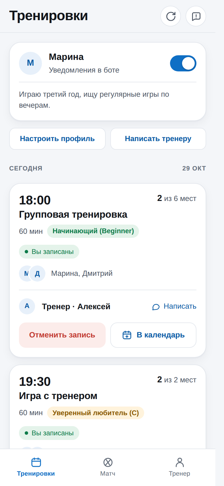
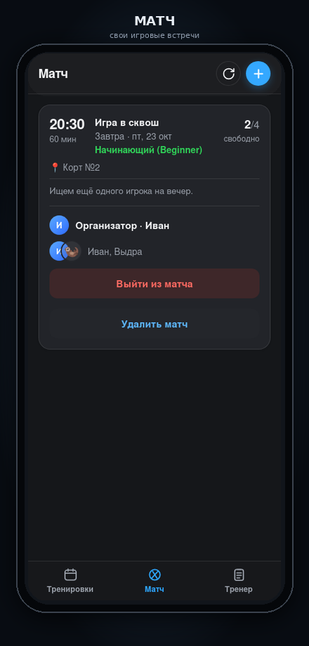
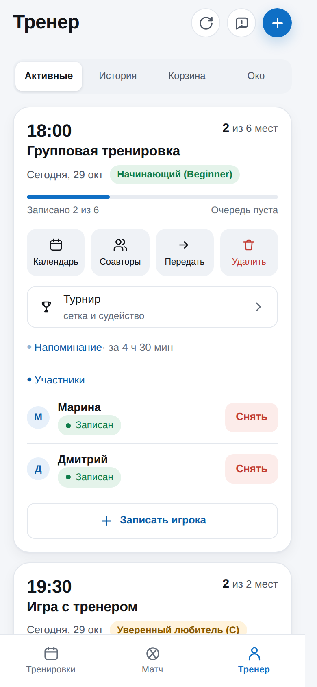
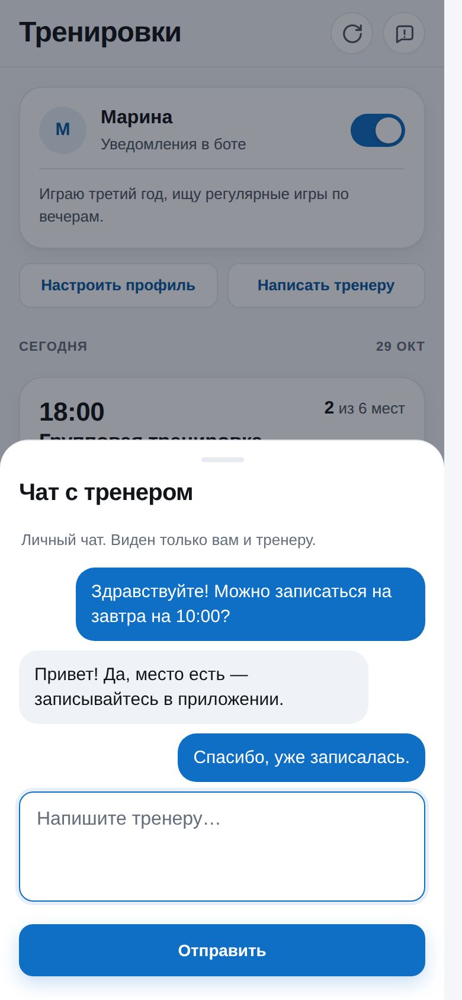

# SQASSIT

Telegram Mini App для сквош-клуба: расписание, запись в один тап, лист ожидания
и CRM тренера — без отдельного мобильного приложения.

Python 3.11+ · FastAPI · aiogram 3 · SQLite


## Примеры интерфейса

<p align="center">
  <a href="docs/screenshots/player.png"></a>
  <a href="docs/screenshots/match.png"></a>
  <a href="docs/screenshots/coach.png"></a>
  <a href="docs/screenshots/chat.png"></a>
</p>

Нажмите на изображение, чтобы открыть его в полном размере.

## Как устроено

<p align="center">
  <a href="docs/ARCHITECTURE.md"></a>
</p>

Telegram открывает приложение и доставляет уведомления; FastAPI и aiogram
обрабатывают запросы, SQLite хранит данные.

[Подробнее об архитектуре и потоках](docs/ARCHITECTURE.md) — компоненты, путь заявки и приватность чата.

## Что умеет

- запись на тренировки, лист ожидания FIFO, напоминания и `.ics`;
- создание серии тренировок по выбранным дням недели в периоде;
- вкладка «Матч» для своих игровых встреч и поиска игроков;
- публичные профили игроков и настройки уведомлений: матчи, тренировки, сообщения;
- обратная связь: проблема или предложение прямо из приложения;
- несколько тренеров, роли, заявки и передача занятий;
- CRM, заметки и чат игрока с тренером в приложении;
- приватность: имя и фото можно скрыть под животным, телефон и username для модерации видит только тренер, Telegram ID не показываются в чатах;
- история, корзина, экспорт и удаление персональных данных.

## Быстрый старт

```bash
git clone https://github.com/difp/sqassit.git
cd sqassit
make install
cp .env.example .env
# BOT_TOKEN, COACH_TELEGRAM_ID, WEBHOOK_BASE_URL
mkdir -p data
make run
```

Минимальный `.env`:

```ini
BOT_TOKEN=...
COACH_TELEGRAM_ID=...
WEBHOOK_BASE_URL=https://...
```

Telegram Web App работает только по HTTPS. Продакшен:
`make install-prod` + systemd + reverse-proxy — см. [`docs/DEPLOY.md`](docs/DEPLOY.md).

## Документация

- [`docs/ARCHITECTURE.md`](docs/ARCHITECTURE.md) — компоненты, заявки и приватность чата.
- [`docs/DEPLOY.md`](docs/DEPLOY.md) — VPS, systemd, HTTPS, бэкапы.
- [`docs/COACHES.md`](docs/COACHES.md) — роли, заявки, передача занятий.
- [`docs/PRIVACY.md`](docs/PRIVACY.md) — данные, приватность, экспорт и удаление.
- [`SECURITY.md`](SECURITY.md) — как сообщить об уязвимости.
- [`CHANGELOG.md`](CHANGELOG.md) — история изменений.

## Лицензия

[MIT](LICENSE)
