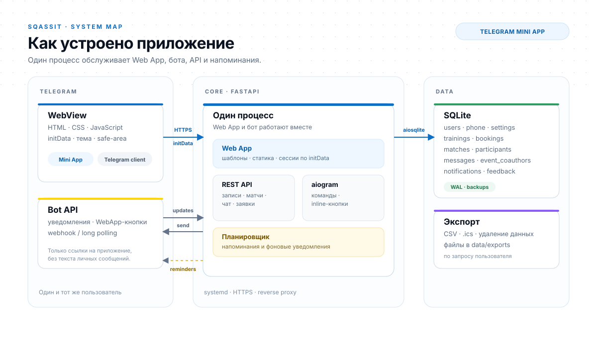
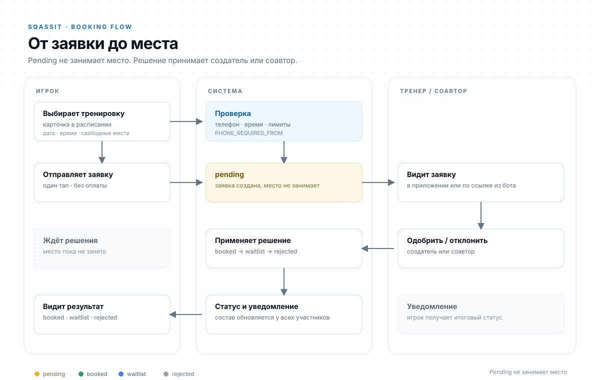
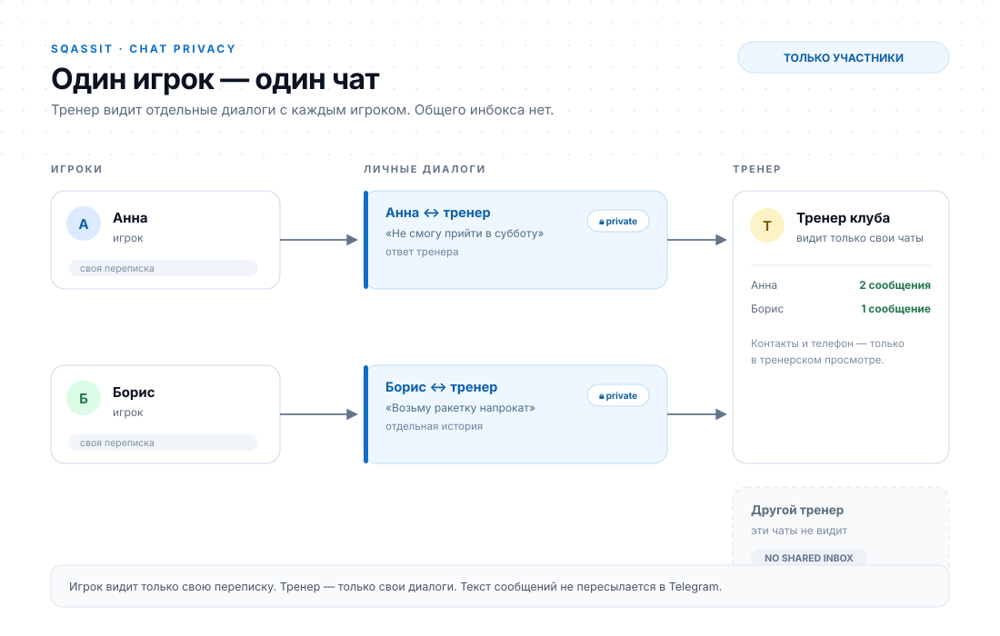

# Архитектура и потоки

Визуализации для репозитория: как SQASSIT устроен внутри, как проходит заявка
и как разделены личные чаты.

## Компоненты

  

Один процесс FastAPI обслуживает Web App, REST API, aiogram-бота и планировщик
напоминаний. Данные хранятся в SQLite. Telegram присылает `initData` для
авторизации, а бот — только уведомления и кнопки перехода в приложение.

## Путь заявки

  

Заявка создаётся в статусе `pending` и не занимает место. Создатель занятия или
соавтор подтверждает или отклоняет её; после решения назначается `booked` или
`waitlist`, либо заявка получает `rejected`.

## Приватность чата

  

У тренера отдельный диалог с каждым игроком. Другие игроки и тренеры эти
переписки не видят, общего инбокса нет. Текст сообщений не пересылается в
Telegram — бот присылает только уведомление.

## Исходники

- [`diagrams/architecture.svg`](diagrams/architecture.svg)
- [`diagrams/booking-flow.svg`](diagrams/booking-flow.svg)
- [`diagrams/chat-privacy.svg`](diagrams/chat-privacy.svg)

Схемы статические, без внешних зависимостей и шрифтов; их можно править как
обычный SVG.
